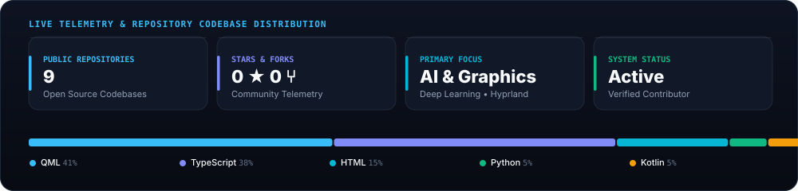

<!-- 3D ISOMETRIC WORKSTATION HERO -->

 

<!-- TELEMETRY BADGES -->

 

### `// 01 · THESIS & ARCHITECTURAL FOCUS`

> *"Engineering at the intersection of computational intelligence, Linux desktop compositors, and robust backend systems."*

I am a software developer and systems builder dedicated to crafting mathematically sound, high-throughput software and bespoke graphic environments. My work spans from architecting custom **Hyprland** Wayland desktop interfaces with real-time astronomical ephemeris calculations and Nothing OS glyph aesthetics, to deploying **computer vision pipelines** and Linux voice-to-text engines in Python, Golang, and C.

---

### `// 02 · SPOTLIGHT SYSTEMS & REPOSITORIES`

| System / Repository | Architecture & Engineering Highlights | Core Stack |
| :--- | :--- | :--- |
| **🌌 [`ricing`](https://github.com/vaishnosingh/ricing)** | Custom **Hyprland** + Nothing OS Glyph interface powered by Swiss Ephemeris astronomical calculations, Nakshatra celestial mechanics, real-time moon phase gravity orb, and MagicUI morphing clock. | `QML` • `Wayland` • `Linux` • `Ephemeris Math` |
| **🎙️ [`JUST-SAY-IT`](https://github.com/vaishnosingh/JUST-SAY-IT)** | High-accuracy, zero-latency Linux speech-to-text converter engineered for automated voice input and desktop workflow acceleration. | `Python` • `Linux Audio API` • `Speech Processing` |
| **👁️ [`Face-Sentiment-prediction`](https://github.com/vaishnosingh/Face-Sentiment-prediction)** | Real-time computer vision pipeline for facial landmark extraction and deep learning emotion classification. | `Python` • `OpenCV` • `PyTorch` • `CNN` |
| **⚡ [`COSMOS`](https://github.com/vaishnosingh/COSMOS)** | Turn legacy hardware into a high-performance Unix workstation through kernel, compositor, and terminal optimization. | `Unix` • `Shell` • `Performance Tuning` |

---

### `// 03 · MODULAR TECHNICAL ARSENAL`

  

---

### `// 04 · LIVE TELEMETRY & ACTIVITY`

  

    

  <!-- DYNAMIC CONTRIBUTION SNAKE -->
  <picture>
    <source media="(prefers-color-scheme: dark)" srcset="https://raw.githubusercontent.com/vaishnosingh/vaishnosingh/output/github-snake-dark.svg"/>
    <source media="(prefers-color-scheme: light)" srcset="https://raw.githubusercontent.com/vaishnosingh/vaishnosingh/output/github-snake.svg"/>
    
  </picture>

    

  <!-- DYNAMIC ACTIVITY GRAPH -->
  

---

### `// 05 · DIRECT COMMUNICATION CHANNELS`

  
  
  
  
  

 

  

