<!-- HERO 3D SHOWCASE -->

 

<!-- TOP METRIC BADGES -->

  

<!-- SECTION 01: ABOUT ME -->

  

<!-- SECTION 02: TECH STACK -->

  

<!-- SECTION 03: METRICS & ACTIVITY -->

 

  

<!-- CONTRIBUTION SNAKE ANIMATION -->
<picture>
  <source media="(prefers-color-scheme: dark)" srcset="https://raw.githubusercontent.com/vaishnosingh/vaishnosingh/output/github-snake-dark.svg"/>
  <source media="(prefers-color-scheme: light)" srcset="https://raw.githubusercontent.com/vaishnosingh/vaishnosingh/output/github-snake.svg"/>
  
</picture>

  

<!-- SECTION 04: CONNECT -->

  
  
  
  
  

 

<!-- FOOTER -->

