<!-- HERO TELEMETRY HUD -->

  

<!-- SECTION 01: ABOUT -->

  

<!-- SECTION 02: TECH STACK & ORBIT -->

 

  

<!-- SECTION 03: LIVE METRICS & CONTRIBUTION SKYLINE -->

 

<!-- LIVE CONTRIBUTION SNAKE (FROM .github/workflows/snake.yml) -->
<picture>
  <source media="(prefers-color-scheme: dark)" srcset="https://raw.githubusercontent.com/vaishnosingh/vaishnosingh/output/github-contribution-grid-snake-dark.svg" />
  <source media="(prefers-color-scheme: light)" srcset="https://raw.githubusercontent.com/vaishnosingh/vaishnosingh/output/github-contribution-grid-snake.svg" />
  
</picture>

  

<!-- SECTION 04: CONNECT -->

  
  
  
  

<!-- FOOTER -->

