 

<h2>🧑‍💻 About me</h2>

  

<table align="center">
  <tr>
    <td align="center" width="25%"><h3>🔭</h3><b>Working on</b> Python, AI and ML</td>
    <td align="center" width="25%"><h3>🌱</h3><b>Learning</b> Golang and TensorFlow</td>
    <td align="center" width="25%"><h3>💬</h3><b>Ask me about</b> Python, Data Structures &amp; Algorithms</td>
    <td align="center" width="25%"><h3>📫</h3><b>Reach me</b> <a href="mailto:vaishnosingh9@gmail.com">vaishnosingh9@gmail.com</a></td>
  </tr>
</table>

⚡ Fun fact: I think I am funny 🌝 &nbsp;(the jury is still out)

<h2>🛠️ Tech stack</h2>

 

<table align="center">
  <tr><td align="right"><b>Languages</b></td><td></td></tr>
  <tr><td align="right"><b>Backend</b></td><td></td></tr>
  <tr><td align="right"><b>Databases</b></td><td></td></tr>
  <tr><td align="right"><b>AI / ML / CV</b></td><td></td></tr>
  <tr><td align="right"><b>Tools &amp; OS</b></td><td></td></tr>
</table>

<!--
  FEATURED PROJECTS (optional): uncomment and replace REPO_NAME with your repo names.

  
  <h2>🚀 Featured projects</h2>
  
-->

<h2>📊 GitHub stats</h2>

<h2>🏆 Trophies</h2>

<h2>🐍 Contribution snake</h2>

<picture>
  <source media="(prefers-color-scheme: dark)" srcset="https://raw.githubusercontent.com/vaishnosingh/vaishnosingh/output/github-snake-dark.svg"/>
  <source media="(prefers-color-scheme: light)" srcset="https://raw.githubusercontent.com/vaishnosingh/vaishnosingh/output/github-snake.svg"/>
  
</picture>

<h2>🌐 Connect with me</h2>

  

